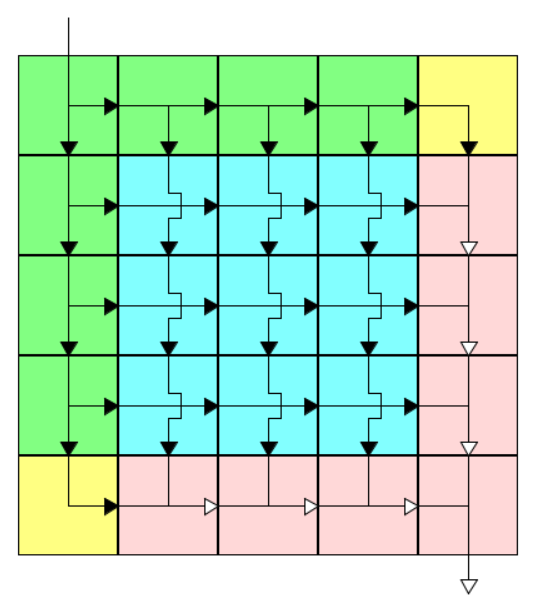

Midterm project of **Advanced Programming Course – Dr. Moghtadaee**

---

## Problem Statement

Write a program that takes the structure of a **magic machine** and a string as input, and then outputs the result of applying the machine to the given string.

In the figure below:

<div align="center">



</div>


* **Black arrows (black functions)** represent functions that take one string as input and return one string as output.
* **White arrows (white functions)** represent functions that take two strings as input and return one string as output.

The magic machine is always a square of size `n × n`. The types of its cells are as follows:

* **Green cells**:

  * Located on the **top** and **left** edges of the machine.
  * Contain a black function.
  * Any input they receive (from the top or left) will be transformed by the function and passed to their right and bottom neighbors.

* **Yellow cells**:

  * Located at the **top-right** and **bottom-left** corners.
  * Contain a black function.
  * Transform the input and pass it to their bottom or right neighbor.

* **Blue cells**:

  * Located inside the machine.
  * Contain **one black function**.
  * Apply the function on both inputs:

    * Input from the top → apply function → pass to bottom neighbor.
    * Input from the left → apply function → pass to right neighbor.

* **Pink cells**:

  * Located on the **right** and **bottom** edges.
  * Contain a **white function**.
  * Apply the function on two inputs (from the left and from the top).
  * The result is passed downwards or rightwards.

The **input string** is fed into the **top-left cell**, and the **output of the bottom-right cell** is considered the final output of the whole machine.

⚠️ **Important**: For white functions, the **left input comes first**, and the **top input comes second**.

---

## Functions

### Black functions (operate on one string):

1. Reverse the string.

   ```
   amir → rima
   ```
2. Repeat each character.

   ```
   amir → aammiirr
   ```
3. Repeat the whole string.

   ```
   amir → amiramir
   ```
4. Shift characters one position to the right.

   ```
   amir → rami
   ```
5. Replace each character with its opposite in the alphabet.

   ```
   amir → znri
   ```

---

### White functions (operate on two strings):

1. Interleave the characters of the two strings.

   ```
   amir, pegah → apmeigrah
   ```
2. Reverse the second string and append it to the first.

   ```
   amir, pegah → amirhagep
   ```
3. Alternate between the first string (left to right) and the second string (right to left).

   ```
   amir, pegah → ahmaigrep
   ```
4. If the length of the first string is even → return the first string, otherwise return the second.

   ```
   amir, pegah → amir
   ```
5. Add characters of both strings modulo 26. If lengths differ, append the extra characters unchanged.

   ```
   amir, pegah → pqorh
   ```

---

## Input

* First line: integer `n`, the size of the magic machine.
* The machine’s cells are randomly filled with numbers between `1` and `5` (representing function IDs).
* Second line: a lowercase English string of length **between 5 and 20**.

---

## Output

* A string of lowercase English letters: the final output of the magic machine.

---

## Example

### Input

```
8
qmiqwnhwnrckeirepjgv
```

### Randomly generated machine

```
2 5 5 4 2 1 5 5 
2 1 2 4 4 1 5 4 
4 4 1 1 1 5 1 4 
4 1 4 4 1 4 5 1 
1 1 1 5 1 4 4 5 
4 4 5 4 5 1 5 5 
1 4 4 4 1 1 1 4 
4 5 4 5 5 1 4 4 
```

### Output

```
vemehewewjijejzjznenancncryrgrlrljjjpjljldedvdtdtmomimumusdsssosodldcdzdzmdmhmvmzizikizizxzxhxzxzpzptpzpzvzvdvzvzrzrirzrzizimizizvzvkvzvzkzktkzkzqzqwqzqztztotzt
```
